# PARADOX / v2

## Apply to your existing profile repository

Download `ethical-paradox-v2.zip` to Downloads. In PowerShell, go to your existing local `EthicalMaster` profile repo (adjust path if needed):

```powershell
cd "$HOME\Downloads\EthicalMaster"
git status
```

Make sure the working tree is clean. Then create a backup branch and extract the ZIP over this directory:

```powershell
git pull --ff-only origin main
git branch backup/origin-v1
Expand-Archive -Path "$HOME\Downloads\ethical-paradox-v2.zip" -DestinationPath . -Force
git add README.md assets/paradox.gif assets/paradox.png assets/axiom.gif assets/axiom.png assets/aven.gif assets/aven.png assets/agent.gif assets/agent.png assets/portfolio.gif assets/portfolio.png tools APPLY.md
git diff --cached --stat
git commit -m "feat: PARADOX cinematic profile redesign"
git push origin main
```

Your original ORIGIN assets remain untouched. No force push or deletion is necessary. If the backup branch name is already used, choose another name.

All images are relative paths hosted in the repository. The GIFs play without browser JavaScript. The standalone HTML preview respects `prefers-reduced-motion`; GitHub GIF playback is controlled by the browser/GitHub, and static alternatives are linked in the README. The README itself is ordinary GitHub Markdown, not a standalone website.

## Optional contribution artwork

The native GitHub contribution graph already appears below the profile. To also generate a monochrome graph from real data, copy `tools/contribution-workflow.yml` into `.github/workflows/contributions.yml`, commit and push, then manually run the workflow from Actions. The workflow has read/write repository contents permission and updates only `assets/contributions.svg` when data changes; it queries GitHub's GraphQL API for the public profile's contribution calendar. It will fail rather than invent data if the token or API is unavailable. Repository settings must allow workflows to write repository contents; a push may also require workflow permission.

Only after the first successful workflow run, add this under the activity section of README.md:

```html

```

## Regenerate art (optional)

The supplied artwork is ready to use. No Python or API keys are needed to display it. To rebuild it, install Python 3.11+, NumPy, Pillow and Numba, and point `PARADOX_FONT_DIR` to your installed Inter Display fonts and `PARADOX_MONO_FONT` to a local monospace font file. No fonts are bundled. Then run `python tools/render.py`.
