<!-- ETHICALMASTER / PARADOX 3.1 — BEYOND THE CODE -->

<a href="https://github.com/EthicalMaster">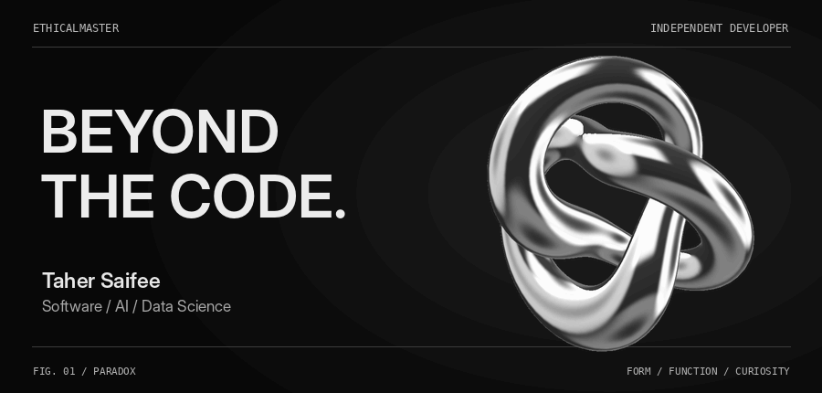</a>

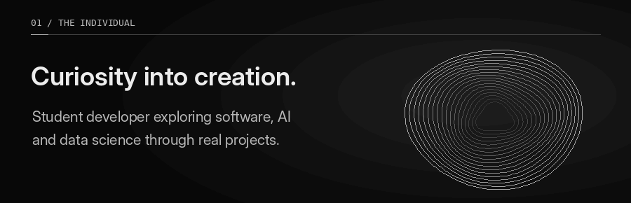

<a href="https://github.com/EthicalMaster/Myportfolio">Portfolio source ↗</a> &nbsp; / &nbsp; <a href="https://github.com/EthicalMaster?tab=repositories">Explore repositories ↗</a>

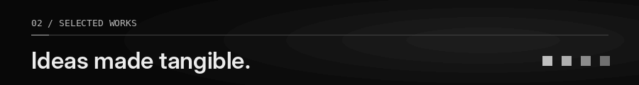

<a href="https://github.com/EthicalMaster/AXIOM-LAB">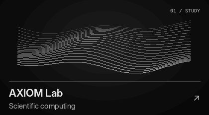</a>
<a href="https://github.com/EthicalMaster/Aven-studypartner">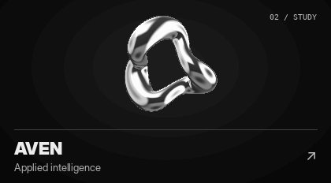</a>
<a href="https://github.com/EthicalMaster/google-adk-workshop-agents">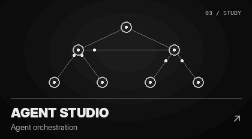</a>
<a href="https://github.com/EthicalMaster/Myportfolio">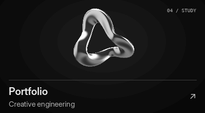</a>

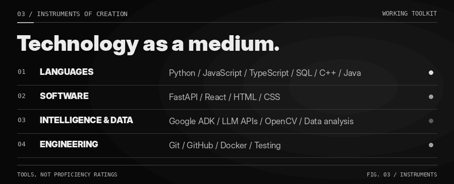

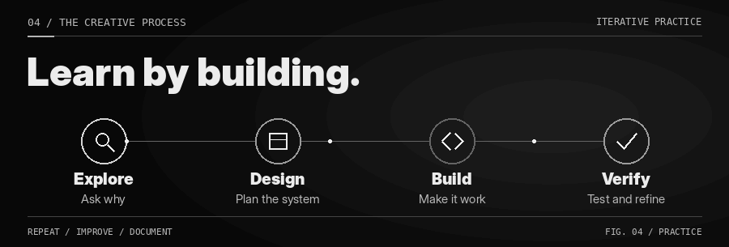

<a href="https://github.com/EthicalMaster#js-contribution-activity"></a>

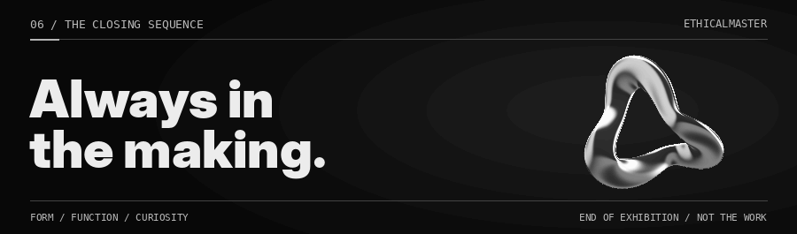

<a href="https://github.com/EthicalMaster?tab=repositories">Repositories ↗</a> &nbsp; / &nbsp; <a href="https://github.com/EthicalMaster/Myportfolio">Portfolio ↗</a> &nbsp; / &nbsp; <a href="STATIC.md">Static edition ↗</a>

Text edition, project descriptions & artwork information

I'm a student developer exploring software engineering, artificial intelligence and data science. I enjoy building useful applications, understanding the systems behind them and exploring creative technology.

- [AXIOM LAB](https://github.com/EthicalMaster/AXIOM-LAB) — A local-first scientific computing environment for data exploration and reproducible analysis; in development.
- [AVEN StudyPartner](https://github.com/EthicalMaster/Aven-studypartner) — AI-assisted study resources and learning workflows.
- [Agent Studio](https://github.com/EthicalMaster/google-adk-workshop-agents) — Google ADK experiments in tool use, planning, parallel execution and review.
- [Interactive portfolio](https://github.com/EthicalMaster/Myportfolio) — Reactive particle art, creative coding and accessible motion design.

**Toolkit:** Python, JavaScript, TypeScript, SQL, C++, Java, FastAPI, React, HTML, CSS, Google ADK, LLM APIs, OpenCV, data analysis, Git, GitHub, Docker and testing. These are tools I work with or explore, not proficiency ratings.

**Process:** Explore → design → build → verify → repeat. I value understanding why systems work, documenting decisions and improving projects incrementally.

The contribution landscape uses data visible to the profile repository's GitHub Actions token, not invented metrics. The native GitHub graph remains the authoritative view. The gallery artworks are original procedural illustrations, not screenshots or measurements. [Static edition](STATIC.md) · [Installation and regeneration](APPLY.md).

