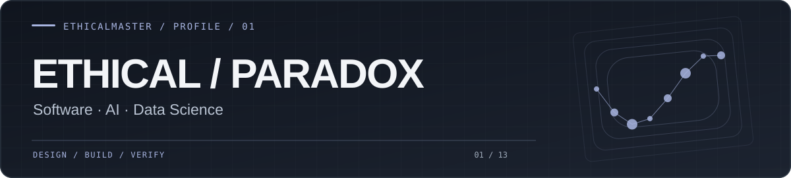
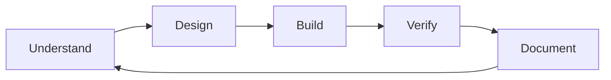

# ETHICAL / PARADOX

**Software · AI · Data Science**

 

Python · TypeScript · SQL · FastAPI · React · Git

---

## 01 / About

I am a student developer exploring software engineering, AI agents, scientific computing and creative interfaces. I build to understand the system behind the interface, and prefer evidence over inflated claims.

**B.Tech CSE (Data Science)** · Acropolis Institute of Technology and Research

**BS Data Science & Applications** · IIT Madras, Foundation level

[LinkedIn](https://www.linkedin.com/in/taher-saifee/) · [Repositories](https://github.com/EthicalMaster?tab=repositories) · [Portfolio](https://tsportfolio-sandy.vercel.app/)

## 02 / Selected work

| Project | Engineering focus | Stage |
|---|---|---|
| [AXIOM LAB](https://github.com/EthicalMaster/AXIOM-LAB) | Scientific computing, data provenance, reproducibility | Release candidate |
| [AVEN](https://github.com/EthicalMaster/Aven-studypartner) | Retrieval, adaptive study and AI gateway | Learning platform |
| [Benchslip](https://github.com/EthicalMaster/Benchslip) | Audit evidence, verification and corrective feedback | Portable tool |
| [SPECTR Workspace](https://github.com/EthicalMaster/SPECTR-Workspace) | Owner-configurable personal workspace | v1.32.0 source |
| [Foliovera](https://github.com/EthicalMaster/FOLIOVERA) | Evidence-backed career intelligence | Single-owner MVP |
| [Agent Studio](https://github.com/EthicalMaster/google-adk-workshop-agents) | Google ADK and multi-agent planning | Workshop demo |
| [MOKI](https://github.com/EthicalMaster/Moki-personal_AI_staff) | Human-approved schedule adjustment | Team scaffold |
| [Myportfolio](https://github.com/EthicalMaster/Myportfolio) | Motion, creative coding and CMS | Interactive portfolio |
| [Sarra Studio](https://github.com/EthicalMaster/Sarraportfolio) | Editorial architecture portfolio | Web project |

## 03 / Toolkit

| Area | Technologies I use or explore |
|---|---|
| Software | Python, JavaScript, TypeScript, SQL, C++, Java |
| Web | FastAPI, React, Express, HTML/CSS, Canvas |
| AI and data | Google ADK, LLM APIs, retrieval, statistics, data analysis |
| Engineering | Git, Docker, tests, SQLite, PostgreSQL, Supabase |

## 04 / Build loop

## 05 / Contribution landscape

The existing [contribution workflow](.github/workflows/paradox-contributions.yml) refreshes this artwork weekly or manually. Its token-visible data may differ from the native GitHub calendar; the native graph remains authoritative. [Static artwork edition](STATIC.md).

## 06 / Activity

[Public repository index](https://github.com/EthicalMaster?tab=repositories) · [Profile contributions](https://github.com/EthicalMaster#js-contribution-activity)

Previous README and documentation provenance

[Original README at the reviewed revision](https://github.com/EthicalMaster/EthicalMaster/blob/f63c72273a2282f92e95d96acd954a10546cec19/README.md). The previous file remains in Git history, including detailed historical commands and release notes. This overview reflects the inspected default branch, not unpublished local work.

---

ETHICALMASTER · DOCUMENTATION SERIES / 01

