<!-- ETHICAL / ORIGIN — profile README -->

## 01 — About

I'm a student developer exploring software engineering, artificial intelligence and data science. I enjoy building useful applications, understanding the systems behind them, and experimenting with creative web experiences.

My interests span AI agents, scientific computing, backend development and motion design.

## 02 — Selected work

| Project | What I'm exploring |
| :--- | :--- |
| [AXIOM LAB](https://github.com/EthicalMaster/AXIOM-LAB) | A local-first scientific computing environment; data exploration and reproducible analysis. In development. |
| [AVEN StudyPartner](https://github.com/EthicalMaster/Aven-studypartner) | AI-assisted learning workflows and study resources. |
| [Agent Studio](https://github.com/EthicalMaster/google-adk-workshop-agents) | Tool-using agents and multi-agent planning, parallel execution and review with Google ADK. |
| [Interactive portfolio](https://github.com/EthicalMaster/Myportfolio) | Creative coding, reactive particles, accessible interactions and motion. |

## 03 — Toolkit

| Area | Technologies I work with or explore |
| :--- | :--- |
| Languages | Python · JavaScript · TypeScript · SQL · C++ · Java |
| Application development | FastAPI · React · HTML · CSS |
| AI & data | Google ADK · LLM APIs · OpenCV · Data analysis |
| Engineering | Git · GitHub · Docker · Testing |

## 04 — How I build

I value understanding why something works, not just getting it to work. I am learning to document decisions, test assumptions and improve projects incrementally.

## 05 — Activity

[Explore my public repositories →](https://github.com/EthicalMaster?tab=repositories)

<!-- The native GitHub contribution graph below this README is the source of truth. -->

---

ETHICALMASTER / ALWAYS EXPLORING

